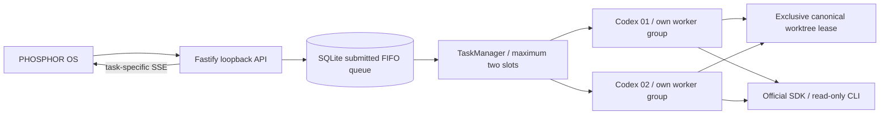

# v0.3 Milestone A architecture

The runtime supports two human-directed read-only Codex agents. It builds on the merged PHOSPHOR OS UI and unchanged official SDK 0.162.1 transport. [Milestone A verification and limits](V0_3_MILESTONE_A.md) distinguish deterministic fixture coverage from historical real model checks.

## Runtime and rationale

Fastify remains appropriate for the small loopback API, lifecycle hooks and persistent task-scoped SSE. React/Vite renders two actual workstations. Node 24 SQLite provides transactional schema migration, queue ordering and history; one backend owns each dedicated data directory through its server lease.

TaskManager owns a map of fixed `codex-1`/`codex-2` slots. Each slot has a distinct provider instance, worker home, active task/session and cleanup promise. Provider instances retain their one-run guard. The scheduler never invents tasks, plans autonomously or enables writing.

## Queue and ownership

Creating a task records its explicit agent assignment, but does not submit it. Start validates ownership/readiness/resume, persists an ordered entry with authentication mode and optional resume session, then pumps the queue. Submission is bounded to 100 waiting entries; each configured agent can reserve only its oldest entry. A blocked head waits, rather than letting later work for that agent overtake it. Other agents may proceed.

Slot and canonical Git-directory reservations are synchronous before filesystem awaits. Dispatch revalidates the repository, acquires the OS-local worktree lease, revalidates the saved session, then atomically removes the queue entry and marks the task running. Another process's lease leaves the task queued and retries at roughly 500 ms, with no SDK execution. This per-application concurrency limit is two; it is not a fleet-wide rate or cost quota.

The lock root is fixed `/tmp/ai-office-worktrees-<uid>` so different `TMPDIR` settings cannot bypass exclusion. Keys hash canonical worktree Git directories: symlink aliases contend; distinct linked worktrees have distinct identities. Private owner records never enter HTTP responses. Stale leases are not stolen based on a PID check.

Workers are separate detached POSIX process groups. Stop addresses one slot, waits through preflight/abort/process reaping and only then releases its lease. Shutdown closes SSE, concurrently stops claimed work, preserves unclaimed queue entries, then closes SQLite/server lease. Workers abort on parent disconnect; after a hard crash, stale leases require manual inspection. Queue dispatch begins only after a successful HTTP listen, so a port conflict cannot start recovered tasks.

## Provider contract

`src/server/providers/types.ts` defines:

- `startSession(repositoryPath)` preflights the selected connection and creates a local handle; the SDK starts the actual thread lazily on execution.
- `resumeSession(repositoryPath, threadId, binding)` verifies the saved execution binding and recreates a handle using an application-owned saved thread.
- `executeTask(session, prompt)` starts one run.
- `streamEvents(session)` yields normalized thread, progress, result, and failure events until the worker exits.
- `stopSession(session)` waits for cancellation and process cleanup.

`ClaudeCodeProvider` is a future implementation, not a placeholder that pretends to work. Its session/thread representation, approval capabilities, and cancellation behavior can differ without changing the dashboard's task model. Milestone A configures two independent CodexProvider instances; no other provider is implemented.

## SDK inspection

Inspected the installed SDK **0.162.1** before writing the adapter: its `dist/index.d.ts`, `dist/index.js`, and README. The package is pinned exactly and locked with npm.

Verified APIs: `new Codex(options)`, `startThread(options)`, `resumeThread(id, options)`, and `thread.runStreamed(prompt, { signal })`. The thread ID is initially null and becomes available in `thread.started`; the manager persists it immediately. Completed agent messages may be interim commentary: these stream as progress, and the latest message becomes a final result only after `turn.completed`. Failures are normalized before persistence/browser delivery; a specific authentication/connection category takes precedence over a subsequent generic CLI exit error.

`CodexAuth` separates public connection status from server-only execution configuration. It uses metadata-only `account/read`/`model/list` on the existing CLI, then passes an allowlisted CLI environment through the supervised worker over private IPC. The worker retains its own private home. A fixed local launcher disables inherited user execution configuration/rules; the tested profile and user review routing stay explicit. Local mode excludes keys; explicit API mode uses a separate isolated home. Connection changes cannot race a task start.

The SDK spawns `codex exec` and reads JSONL. It accepts `TurnOptions.signal` and passes it to Node's child spawn. Its cleanup sends a termination signal, but it exposes neither the CLI PID nor a hard-kill API. Our adapter supervises an isolated worker/process group, requests SDK abort first, then kills the remaining group if necessary. The repository lease is held until cleanup finishes. Parent disconnect also aborts the worker; stale leases remain after unclean crashes.

There is **no interactive approval callback** in this SDK surface. Consequently this runtime remains read-only and provides proposals instead of applying changes. Approval-required operations are denied by the noninteractive runtime rather than approved in the UI. Full write workflows need a reviewed approval-capable transport (such as a future app-server integration) or a separate explicit proposal/apply design.

The restrictive filesystem profile uses raw `configOverrides` for quoted filesystem keys. The SDK's structured config flattener joins object keys with dots, which cannot safely represent arbitrary filesystem paths. Legacy `sandboxMode` and `networkAccessEnabled` are deliberately omitted because legacy sandbox settings override named permission profiles. Newer documentation retires explicit `untrusted` approval policy despite that literal still appearing in SDK types; this app uses `on-request` and an untrusted project configuration instead.

Official references: [Codex SDK](https://learn.chatgpt.com/docs/codex-sdk), [permission profiles](https://learn.chatgpt.com/docs/permissions), and [approvals/security](https://learn.chatgpt.com/docs/agent-approvals-security). The installed package is the authority for the API actually used here.

## State and persistence

SQLite schema **3** adds `task_queue` (monotonic sequence, task, optional saved session, submitted mode and timestamp), and session agent ownership. DDL, JSON ownership backfill, unfinished-task recovery and `user_version` update share an immediate transaction. Version 1/2 records and bindings survive; missing legacy ownership becomes Codex 01. Newer unknown schemas are rejected. Schema downgrade is not implemented.

`queued` without a queue entry means unsubmitted. `queued` with an entry means authorized pending work. Lease acquisition precedes the atomic queued → running claim. Running/stopping tasks become completed/failed/stopped, or interrupted on unclean restart. Interrupted turns are never automatically retried; a new task can explicitly resume the same agent/repository/provider and compatible model/auth context. Submitted queued work survives restart, but only dispatches with its saved mode; API sessions never silently become local-login sessions or vice versa.

`/dashboard.agents` contains authoritative real slots; `.queue` reports pending entries and safe wait reasons; `.concurrency` reports the bound. `.agent` remains a compatibility view of Codex 01 for older local clients. New UI clients use the agents array. Agent phases reflect preparation, actual SDK events, stopping, or queued waiting; the scene never invents percentages.

The browser opens independent task-specific EventSources for both active tasks plus the selected history task, deduplicates each stream and retains 500 events per visible task. The backend subscribes before replay, supports Last-Event-ID and bounds slow-client buffers/events/results as before. Results and changed-file summaries remain persisted and read-only; pre-existing worktree changes are labeled, not attributed to an agent.

## HTTP API

All mutations require `application/json`, accept strict schemas, and reject extra fields.

| Method | Path                            | Body / behavior                                                      |
| ------ | ------------------------------- | -------------------------------------------------------------------- |
| GET    | `/api/health`                   | Liveness                                                             |
| GET    | `/api/dashboard`                | Agents, queue, concurrency, repositories, sessions, tasks, readiness |
| POST   | `/api/connection`               | `{ mode: "local-cli-chatgpt" \| "api-key" }`, explicit selection     |
| POST   | `/api/connection/refresh`       | `{}`, metadata refresh without inference                             |
| POST   | `/api/repositories`             | `{ path }`, canonical root registration                              |
| POST   | `/api/tasks`                    | `{ repositoryId, agentId: "codex-1" \| "codex-2", title, prompt }`   |
| POST   | `/api/tasks/:id/start`          | `{}` or `{ resumeSessionId }`; enqueue assigned task                 |
| POST   | `/api/tasks/:id/stop`           | `{}`, cancel submitted work or wait for own worker cleanup           |
| GET    | `/api/tasks/:id/events?after=0` | Up to 500 persisted events                                           |
| GET    | `/api/tasks/:id/stream?after=0` | SSE with reconnect replay                                            |

There are no shell, Git mutation, custom executable, arbitrary SDK options, sandbox override, merge, push, or database-operation HTTP endpoints.
