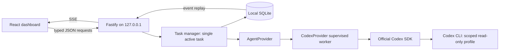

# Phase 1 architecture

Phase 1.2 integrates the verified local ChatGPT CLI transport into the dashboard. Local login is preferred, API billing requires explicit selection, and session bindings protect restart/resume from silently changing execution modes. See [the current implementation and real verification](PHASE_1_2_DASHBOARD.md); [Phase 1.1](PHASE_1_1_CODEX_INTEGRATION.md) remains the historical SDK research record.

## Plan and rationale

Build a single vertical slice: registered Git worktree → queued task → one Codex session → live events → persisted result/history. Keep orchestration explicit and human-directed.

- **Fastify**: a small, local service with lifecycle hooks, streaming support, and test injection. NestJS's dependency-injection/modules layer adds little value for one provider and a handful of endpoints.
- **React + Vite**: a dashboard with task history, one agent card, start/resume/stop controls, output, and repository status.
- **SQLite**: built-in Node 24 driver; WAL mode, foreign keys, versioned schema, parameterized values. Repositories, sessions, tasks, and ordered events survive restart. Only a single backend may own a data directory.
- **SSE**: one-way event delivery is sufficient. Events are persisted before publication and replayed with `Last-Event-ID`; no WebSocket protocol is necessary.
- **Provider boundary**: SDK types remain inside the Codex adapter. Future providers implement the same lifecycle and declare cancellation, approval, and write capabilities.



## Provider contract

`src/server/providers/types.ts` defines:

- `startSession(repositoryPath)` preflights the selected connection and creates a local handle; the SDK starts the actual thread lazily on execution.
- `resumeSession(repositoryPath, threadId, binding)` verifies the saved execution binding and recreates a handle using an application-owned saved thread.
- `executeTask(session, prompt)` starts one run.
- `streamEvents(session)` yields normalized thread, progress, result, and failure events until the worker exits.
- `stopSession(session)` waits for cancellation and process cleanup.

`ClaudeCodeProvider` is a future implementation, not a placeholder that pretends to work. Its session/thread representation, approval capabilities, and cancellation behavior can differ without changing the dashboard's task model. Phase 1 intentionally has only one configured provider and agent.

## SDK inspection

Inspected the installed SDK **0.162.1** before writing the adapter: its `dist/index.d.ts`, `dist/index.js`, and README. The package is pinned exactly and locked with npm.

Verified APIs: `new Codex(options)`, `startThread(options)`, `resumeThread(id, options)`, and `thread.runStreamed(prompt, { signal })`. The thread ID is initially null and becomes available in `thread.started`; the manager persists it immediately. Completed agent messages may be interim commentary: these stream as progress, and the latest message becomes a final result only after `turn.completed`. Failures are normalized before persistence/browser delivery; a specific authentication/connection category takes precedence over a subsequent generic CLI exit error.

`CodexAuth` separates public connection status from server-only execution configuration. It uses metadata-only `account/read`/`model/list` on the existing CLI, then passes an allowlisted CLI environment through the supervised worker over private IPC. The worker retains its own private home. A fixed local launcher disables inherited user execution configuration/rules; the tested profile and user review routing stay explicit. Local mode excludes keys; explicit API mode uses a separate isolated home. Connection changes cannot race a task start.

The SDK spawns `codex exec` and reads JSONL. It accepts `TurnOptions.signal` and passes it to Node's child spawn. Its cleanup sends a termination signal, but it exposes neither the CLI PID nor a hard-kill API. Our adapter supervises an isolated worker/process group, requests SDK abort first, then kills the remaining group if necessary. The repository lease is held until cleanup finishes. Parent disconnect also aborts the worker; stale leases remain after unclean crashes.

There is **no interactive approval callback** in this SDK surface. Consequently Phase 1 is read-only and provides proposals instead of applying changes. Approval-required operations are denied by the noninteractive runtime rather than approved in the UI. Full write workflows need a reviewed approval-capable transport (such as a future app-server integration) or a separate explicit proposal/apply design.

The restrictive filesystem profile uses raw `configOverrides` for quoted filesystem keys. The SDK's structured config flattener joins object keys with dots, which cannot safely represent arbitrary filesystem paths. Legacy `sandboxMode` and `networkAccessEnabled` are deliberately omitted because legacy sandbox settings override named permission profiles. Newer documentation retires explicit `untrusted` approval policy despite that literal still appearing in SDK types; this app uses `on-request` and an untrusted project configuration instead.

Official references: [Codex SDK](https://learn.chatgpt.com/docs/codex-sdk), [permission profiles](https://learn.chatgpt.com/docs/permissions), and [approvals/security](https://learn.chatgpt.com/docs/agent-approvals-security). The installed package is the authority for the API actually used here.

## State and persistence

```text
queued → running → completed | failed
              ↘ stopping → stopped
running/stopping at server restart → interrupted
```

Start reserves the agent synchronously before filesystem/SDK awaits. Path identity is checked at start and before summarization. A per-worktree lease keyed by the canonical Git directory prevents other AI Office instances from using the same worktree. Existing leases are never automatically stolen.

SQLite schema 2 records registered roots, provider session IDs, Codex thread IDs, prompts, final results, errors, event history, and pre-/post-task Git status. Private session bindings retain a non-secret context fingerprint, mode/model/runtime version; they never appear in public dashboard data. Legacy history remains readable without guessing its connection context. Git status uses fixed argument arrays, NUL-delimited parsing, no optional locks, disabled fsmonitor/hooks, bounded buffers, and a timeout. It works without an initial commit.

The changed-file summary is **the complete Git worktree status at finish**, not an attribution claim or patch diff. Files already dirty before the task are labeled. Concurrent changes by editors or unrelated tools are not attributed to Codex. The real provider has no writes; an empty change summary is expected for an initially clean worktree. A failed status inspection is displayed as unavailable, not as zero changes.

SSE subscribes before synchronously replaying stored events. IDs are monotonic SQLite event IDs. Reconnects send `Last-Event-ID`, and the browser deduplicates and retains its latest 500 visible events; persisted events remain queryable in 500-event pages. Slow clients disconnect once their output buffer exceeds 1 MiB. Events have 64 KB message/data limits, final results 256 KB, and tasks a 5000-event/15-minute limit.

## HTTP API

All mutations require `application/json`, accept strict schemas, and reject extra fields.

| Method | Path                            | Body / behavior                                                  |
| ------ | ------------------------------- | ---------------------------------------------------------------- |
| GET    | `/api/health`                   | Liveness                                                         |
| GET    | `/api/dashboard`                | Agent, repositories, sessions, tasks, readiness                  |
| POST   | `/api/connection`               | `{ mode: "local-cli-chatgpt" \| "api-key" }`, explicit selection |
| POST   | `/api/connection/refresh`       | `{}`, metadata refresh without inference                         |
| POST   | `/api/repositories`             | `{ path }`, canonical root registration                          |
| POST   | `/api/tasks`                    | `{ repositoryId, agentId: "codex-1", title, prompt }`            |
| POST   | `/api/tasks/:id/start`          | `{}` or `{ resumeSessionId }`                                    |
| POST   | `/api/tasks/:id/stop`           | `{}`, waits for cleanup                                          |
| GET    | `/api/tasks/:id/events?after=0` | Up to 500 persisted events                                       |
| GET    | `/api/tasks/:id/stream?after=0` | SSE with reconnect replay                                        |

There are no shell, Git mutation, custom executable, arbitrary SDK options, sandbox override, merge, push, or database-operation HTTP endpoints.
