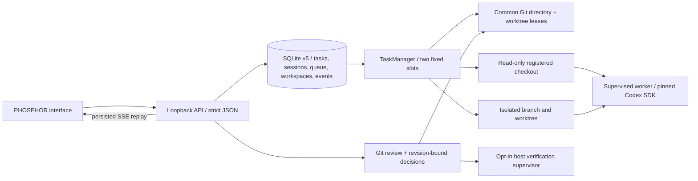

# AI Office v0.4 architecture

Node 24/Fastify owns the loopback API, SQLite metadata and task-scoped SSE. React/Vite renders the existing two-agent PHOSPHOR interface. Each fixed agent slot has an independent Codex provider, private worker home and at most one active task; no orchestration/team framework is introduced.

## Queue and execution

Creation records a task; Start is a separate authorization/submission action. FIFO entries retain authentication mode, assigned agent and optional saved session; at most 100 submissions wait. Dispatch begins only after successful HTTP listen. Slot reservation precedes asynchronous preflight. Common-Git-directory and legacy per-worktree leases serialize aliases across instances; isolated execution also holds the task's actual Git-directory lease. Busy tasks remain queued before claim. Unknown/stale leases fail closed rather than using PID-based stealing.

Read-only is the legacy/default mode. Write tasks require explicit confirmation and operator-configured absolute roots covering both source checkout and Git/common metadata. Workspaces reserves a generated UUID directory and dedicated branch, based on HEAD rather than dirty primary-checkout files. Creation intent and task association are persisted before Git creation. Successful ownership includes canonical paths and device/inode/birth-time fingerprints for the worktree, pointer, Git directory, source root and common metadata.

Authentication preparation can take time, so ownership is checked again immediately before execution. Write resume requires the original execution/authentication modes, repository, agent/provider, native transcript, pending workspace and unchanged HEAD. No reset or implicit privilege upgrade occurs.

## Codex transport and sandbox

The installed/pinned SDK remains `@openai/codex-sdk` 0.162.1. Verified APIs are `startThread`, `resumeThread`, `runStreamed` and AbortSignal. The SDK starts threads lazily and emits `thread.started`; the ID is persisted immediately. Completed agent messages can be interim commentary: only the latest response after `turn.completed` is a final result.

The worker is a detached POSIX process group supervised by the backend. Stop first aborts the SDK, then escalates if needed; backend disconnect also triggers worker termination. The adapter observes worker closure and cleans the group before releasing leases. EPERM is not termination evidence: transient failures get a bounded retry and persistent uncertainty retains leases/reports interruption. Deliberately detached programs remain outside group supervision.

CodexAuth maintains private execution bindings separate from public connection status. Local mode uses existing CLI authentication and excludes key variables; explicit API mode uses a separate isolated home. A fixed launcher ignores inherited user configuration/rules. Agent commands receive a minimal environment. There is no interactive SDK approval channel or automatic approval bypass.

Named filesystem permissions grant either read-only checkout access or writes only in the task directory; Git metadata and known sensitive paths are denied. Raw `configOverrides` preserve quoted filesystem keys rather than the SDK flattener's dotted keys. Legacy sandboxMode/networkAccessEnabled flags are omitted because they override named profiles. Runtime controls, glob timing limits and machine trust assumptions are documented in [security](SECURITY.md), with links to official documentation.

## Review, verification and decisions

Workspaces reads Git diffs independently of thread lifetime, against the saved base commit. Backend Git treats paths literally and suppresses hooks, fsmonitor, filters, external diff/textconv and submodule inspection. Filter-dependent data such as LFS pointer hydration is left to trusted manual handling. Known sensitive paths are withheld and untracked file reads are bounded/no-follow.

The review revision includes ownership/decision, HEAD, index, status, bounded filesystem metadata and command configuration. Keep/Reject/Verify need a fresh revision and state is reloaded under the lease. This detects observed edits; it is not an atomic filesystem snapshot or a lock against external editors.

Keep retains the isolated branch/files and ends continuation. Reject refuses advanced HEAD, ignored files, nested bare/non-bare repositories and ambiguous/large ownership scans. After final validation it records intent and asks Git to remove only the registered worktree; branches remain. No commit, push, reset, merge or automatic integration occurs.

Host verification is disabled unless the operator explicitly enables it and the UI/API separately confirms host execution. It can execute AI-edited project scripts with full OS permissions; it is not protected by the Codex sandbox. A separate minimal-environment worker owns timeout/output bounds and disconnect cleanup. Its result is accepted only after worker/group cleanup. Shutdown aborts verification and stops agents in parallel before closing persistence.

## Persistence and recovery

SQLite v5 uses WAL, foreign keys, bounded events and transactional schema migration. It stores repositories, task/session JSON, private session bindings, submitted FIFO entries, events and workspace ownership/review/operation JSON. Workspace/task attachment is transactional. Legacy tasks/sessions remain read-only; older application readers refuse schema v5.

Filesystem and SQLite changes cannot be committed together. Creation/rejection/verification intents therefore precede external operations. Restart retains unfinished intent as a blocked recovery diagnostic; it never guesses that files are safe to delete or that a command stopped. Workspaces without ownership fingerprints require manual inspection rather than automatic adoption. Review output redaction never rewrites persisted filesystem identity.

Missing/replaced resources, stale leases, native transcript loss and interrupted mutations are described in [workspace recovery](WORKSPACE_RECOVERY.md). Read [the security audit](V0_4_SECURITY_AUDIT.md) and [verification evidence](VERIFICATION.md) for actual findings, tests and remaining limits.
