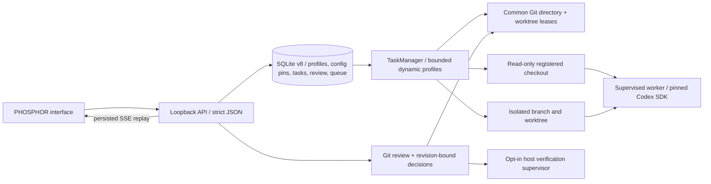

# AI Office architecture — integrated v0.6 Agent Studio and v0.7 Workflow Engine (unreleased)

Node 24/Fastify owns the loopback API, SQLite metadata and task-scoped SSE. React/Vite renders Agent Studio and the PHOSPHOR interface. Stable persisted profiles receive independent lazy Codex providers/private worker homes. At most two turns prepare/run globally, with one per profile; the v0.7 workflow layer adds operator-gated Coder → Reviewer → QA orchestration; it does not introduce unrestricted autonomous agent-to-agent dispatch.

## Queue and execution

Creation records a task; Start is a separate authorization/submission action. FIFO entries retain authentication mode, assigned agent and optional saved session; at most 100 submissions wait. Dispatch begins only after successful HTTP listen. Slot reservation precedes asynchronous preflight. Common-Git-directory and legacy per-worktree leases serialize aliases across instances; isolated execution also holds the task's actual Git-directory lease. Busy tasks remain queued before claim. Unknown/stale leases fail closed rather than using PID-based stealing.

Read-only is the legacy/default mode. Write tasks require explicit confirmation and operator-configured absolute roots covering both source checkout and Git/common metadata. Workspaces reserves a generated UUID directory and dedicated branch, based on HEAD rather than dirty primary-checkout files. Creation intent and task association are persisted before Git creation. Successful ownership includes canonical paths and device/inode/birth-time fingerprints for the worktree, pointer, Git directory, source root and common metadata.

Authentication preparation can take time, so ownership is checked again immediately before execution. Write resume requires the original execution/authentication modes, repository, agent/provider, native transcript, pending workspace and unchanged HEAD. No reset or implicit privilege upgrade occurs.

## Codex transport and sandbox

The installed/pinned SDK remains `@openai/codex-sdk` 0.162.1. Verified APIs are `startThread`, `resumeThread`, `runStreamed` and AbortSignal. The SDK starts threads lazily and emits `thread.started`; the ID is persisted immediately. Completed agent messages can be interim commentary: only the latest response after `turn.completed` is a final result.

The worker is a detached POSIX process group supervised by the backend. Stop first aborts the SDK, then escalates if needed; backend disconnect also triggers worker termination. The adapter observes worker closure and cleans the group before releasing leases. EPERM is not termination evidence: transient failures get a bounded retry and persistent uncertainty retains leases/reports interruption. Deliberately detached programs remain outside group supervision.

CodexAuth maintains private execution bindings separate from public connection status. Local mode uses existing CLI authentication and excludes key variables; explicit API mode uses a separate isolated home. A fixed launcher ignores inherited user configuration/rules. Agent commands receive a minimal environment. There is no interactive SDK approval channel or automatic approval bypass.

Named filesystem permissions grant either read-only checkout access or writes only in the task directory; Git metadata and known sensitive paths are denied. Raw `configOverrides` preserve quoted filesystem keys rather than the SDK flattener's dotted keys. Legacy sandboxMode/networkAccessEnabled flags are omitted because they override named profiles. Runtime controls, glob timing limits and machine trust assumptions are documented in [security](SECURITY.md), with links to official documentation.

## Review, verification and decisions

Workspaces reads Git diffs independently of thread lifetime, against the saved base commit. Backend Git treats paths literally and suppresses hooks, fsmonitor, filters, external diff/textconv and submodule inspection. Filter-dependent data such as LFS pointer hydration is left to trusted manual handling. Known sensitive paths are withheld and untracked file reads are bounded/no-follow.

The review revision includes ownership/decision, HEAD, index, status, bounded filesystem metadata and command configuration. Keep/Reject/Verify need a fresh revision and state is reloaded under the lease. This detects observed edits; it is not an atomic filesystem snapshot or a lock against external editors.

Keep retains the isolated branch/files and ends continuation. Reject refuses advanced HEAD, ignored files, nested bare/non-bare repositories and ambiguous/large ownership scans. After final validation it records intent and asks Git to remove only the registered worktree; branches remain. No commit, push, reset, merge or automatic integration occurs.

Host verification is disabled unless the operator explicitly enables it and the UI/API separately confirms host execution. It can execute AI-edited project scripts with full OS permissions; it is not protected by the Codex sandbox. A separate minimal-environment worker owns timeout/output bounds and disconnect cleanup. Its result is accepted only after worker/group cleanup. Shutdown aborts verification and stops agents in parallel before closing persistence.

## Persistence and recovery

SQLite v8 uses WAL, foreign keys, bounded events and transactional schema migration. It stores repositories, task/session JSON, private session bindings, submitted FIFO entries, events and workspace ownership/review/operation JSON. Workspace/task attachment is transactional. Pre-write legacy tasks/sessions remain read-only; v0.5 writes retain explicit legacy pins. Older readers refuse schema 8.

Filesystem and SQLite changes cannot be committed together. Creation/rejection/verification intents therefore precede external operations. Restart retains unfinished intent as a blocked recovery diagnostic; it never guesses that files are safe to delete or that a command stopped. Workspaces without ownership fingerprints require manual inspection rather than automatic adoption. Review output redaction never rewrites persisted filesystem identity.

Missing/replaced resources, stale leases, native transcript loss and interrupted mutations are described in [workspace recovery](WORKSPACE_RECOVERY.md). Read [the security audit](V0_4_SECURITY_AUDIT.md) and [verification evidence](VERIFICATION.md) for actual findings, tests and remaining limits.

## Revision-bound feedback loop

The Code Review Center extends Workspaces Git review with bounded per-file patches,
availability states and parsed unified line numbers. Store schema 6 adds review_records
(workspace/revision primary key, workspace-local sequence, typed JSON). Patches and
submitted comments stay immutable; draft edits increment a conflict-detection version.
History reads use 20-record pages and never read older file data from the live worktree.

Request Changes runs under the existing review leases. It validates pending ownership,
fresh revision, saved session/thread and connection context, then atomically records
submitted feedback and creates a correction task in the existing FIFO. Internal task
metadata pins the authorized revision/session/thread. The ordinary worker path rechecks
revision and session after authentication and before executing SDK resumeThread. It never
silently starts a replacement thread. Duplicate workspace/revision requests return the
original correction task. No new agent service or queue is introduced.

Every finished write turn and restart-recovered interrupted write advances a workspace
review generation, allowing a new iteration even when its patch is unchanged. History
joins the correction task's persisted status/error; verification records carry their input
revision. Keep/Reject still operate on the current Git state, with the v0.4 preservation
rules. Review records remain after removal. See [workflow/migration](V0_5_REVIEW_CENTER.md)
and [new threat model](V0_5_SECURITY.md).

## Agent Studio registry and immutable configuration

Schema 7 adds deterministic `agent_profiles` and append-only `(agent_id, revision)`
`agent_versions`. Legacy IDs stay unchanged; new profiles use UUIDs, never names as keys.
Schema 8 adds `task_configurations` (immutable submission plus once-set execution JSON) and
`session_configurations`. Enqueue/pin and session/private-binding/config creation are
transactional. Startup migrates queued/session authority from saved legacy metadata without
inventing auth or profile guidance; unknown owners fail the upgrade transaction.

Profiles constrain mode but cannot grant server/worktree/host authority. Guidance is task
text, never raw SDK options. Optional local model selection is catalog-validated and resolved
before execution. API mode requires an explicit model because metadata cannot resolve an
unspecified default. Session resume/corrections reuse original config and binding, or fail.
Review records capture their config; legacy history joins its explicitly migrated session pin.

Production capacity stays two (the internal constructor accepts one/two for fixtures),
independent of saved profile count. The scheduler scans oldest eligible profile heads and
reserves before async work. Confirmed queues survive archival/restart; new assignment is
blocked for archived profiles. Cleanup uncertainty retains leases **and** the occupied
reservation, blocking reuse until manual inspection. SSE stays keyed to task ID.

[Workflow/API and migration limits](V0_6_AGENT_STUDIO.md) and [audit evidence](V0_6_VALIDATION.md)
describe supported behavior. Existing v0.5 review, Git and decision invariants remain in use.

## v0.7 workflow orchestration

The workflow layer persists a revision-bound sequence of Coder, Reviewer and optional QA stages. Coder uses an approved isolated write worktree; Reviewer uses a separately prepared read-only source snapshot; QA runs an operator-selected, server-configured command in a verified native read-only sandbox. Each transition requires an explicit operator decision, including approval of exact evidence and result digests. Workflow-bound tasks cannot bypass these gates via the ordinary task start API. Interrupted or failed workflows require inspection rather than automatic retries. See [workflow implementation and limitations](V0_7_WORKFLOW_ENGINE.md) and [validation](V0_7_VALIDATION.md).

This is a local single-user architecture, not a general multi-tenant scheduler. There is no automatic merge, push or deployment, and Linux native success-path compatibility remains unverified.
