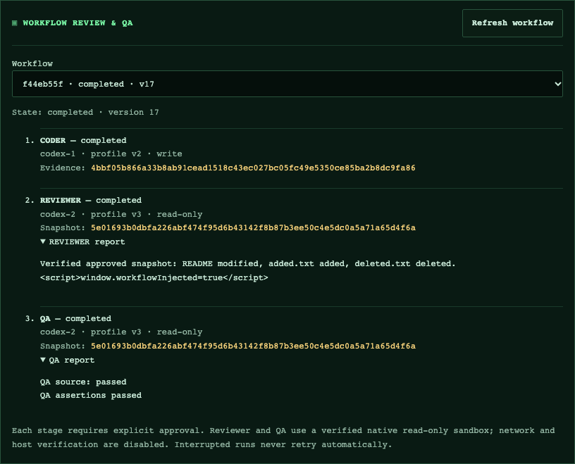

# v0.7 validation — 2026-10-22

Implementation: [workflow, isolation, lifecycle and limits](V0_7_WORKFLOW_ENGINE.md). Implementation was merged through [PR #24](https://github.com/vlovers/ai-office/pull/24); no v0.7 tag, separate release or deployment is established by this document. PR #22 was superseded.

## Local verification

Environment: macOS, Node.js 24.21.0, Codex SDK/CLI 0.162.1.

- **141 unit/integration/security tests passed**: 58 workflow/QA/migration/auth/worktree/Review Center tests, 82 remaining regression tests, and an additional deterministic ordinary-task lease-release regression.
- **2 HTTP/SSE smoke tests passed.**
- TypeScript, production build, formatting and `git diff --check` passed.
- The installed native Codex filesystem policy passed credential-free checks for allowed reads, denied outside/secret reads, denied read-only writes, protected linked-worktree Git metadata and isolated-write boundaries.
- Runtime native preflight additionally checked network denial. Real QA assertions, prohibited writes/secret reads, cancellation, descendant process groups, timeout and bounded output passed.
- All four browser suites passed: dashboard smoke, isolated write/Review Center, Agent Studio/restart, and Coder → Reviewer → QA workflow.
- Browser workflow coverage includes dismissed approvals, stale request versions, changed dialogs, delayed selection responses, read-only Reviewer snapshots, selected QA plans, persistent results, Review Center integration, HTML escaping and mobile overflow checks.
- Migration checks preserve schema-8 tasks, configurations, profiles, independent queues and a closed-file backup. Queued/running QA recovery interrupts without redispatch; repeated restart is idempotent.

CI repeats portable checks on Linux and the native Reviewer/QA plus complete browser journey on macOS. Integration CI #266 passed on the PR #24 delivery path. This document does not establish validation of later `main` commits or a tagged release.

## Real Codex model trial

The backend trial ran on commit `28bb09e5001d86178a4b2edf00677f0fbe962d84`, using the supported bundled CLI, the existing local ChatGPT login and model **gpt-6.1-sol**. Subsequent hardening covers ordinary-task finalization and stale browser state and is checked by regression tests and CI.

Exactly two real model turns were used for this trial: one Coder and one Reviewer. QA ran a real configured shell assertion inside the native read-only sandbox. Every approval was applied explicitly by the trial operator through the ordinary HTTP endpoints. There were no automatic retries, API billing fallback or generated-code commits/pushes.

| Evidence               | Observed value                                                     |
| ---------------------- | ------------------------------------------------------------------ |
| Workflow               | `cac80cd1-1df7-45e8-8b48-aaaa451aab00`                             |
| Final state            | Coder, Reviewer, QA and workflow completed                         |
| Coder fingerprint      | `2d6cfc2064b2661c99b906653f77778aade35f3dde05bb332ff3ad677121707c` |
| Source digest          | `37bd133d2a0ed88648bc8658b856add161b34043905af1108d4a0609cc0691ca` |
| Reviewer report digest | `622db2c269f7dcfcdc530abce6fe65d34347ac524621e34ecbb637c002a7343c` |
| QA report digest       | `9c64b1550e1d919bb1b725613696b06a748c41c6841d3ad18103f23f8b43977a` |
| Primary checkout       | Original HEAD, clean Git status and original README all preserved  |
| QA result              | `QA content: passed` and `Live QA assertions passed`               |

Coder replaced a placeholder in the disposable README. Reviewer inspected the exact approved snapshot and reported no actionable defects at `README.md:1`. This proves live transport/orchestration/isolation on a small task, not review quality on a complex application. Full SQLite, task results, snapshots and `verification.json` remain in the local disposable trial directory, whose name ends with `ai-office-real-workflow-LnQfa7`.

## Operational limits before release

- Native macOS success paths are verified; native Linux success paths still require verification on an explicitly supported host. Unsupported native policy blocks dispatch.
- QA is read-only with no network. Suites requiring installation, dependency trees outside authorized paths, caches, coverage/build writes or services need a separately isolated runner. Host verification is not a workaround.
- Source/bundle size and file-type limits are deliberate; large or sensitive repositories can require manual review.
- Cleanup of owned terminal artifacts is explicit and journaled. Unknown leases, failed cleanup and orphan directories require operator inspection; automatic orphan garbage collection is not implemented.
- Release and real-installation backup/rollback review remain separate decisions. No unattended model retry, merge, release or deployment is provided.

## Browser evidence

Synthetic SDK transport, real native sandbox and production dashboard; no inference or credentials in these captures. The malicious HTML in the report is intentionally rendered as literal text.

[Mobile capture](design/screenshots/v07-workflow-mobile.png). CI uploads the browser captures as the `workflow-browser` artifact.
